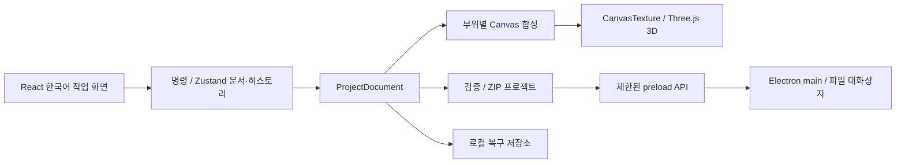

# 아키텍처

STULOOMA 0.2.0 작업 공간 패치는 로컬 우선 Electron 애플리케이션이다. 브라우저 개발 화면은 같은 React 편집기를 실행하지만 파일 저장은 다운로드/업로드를 사용한다. Electron에서는 main 프로세스가 파일 대화상자와 디스크 접근을 담당한다.

## 모듈 경계와 입출력

| 모듈 / 실제 위치 | 책임 | 입력 → 출력 |
|---|---|---|
| `electron/main` | 창 수명·로컬 렌더러·CSP·파일 대화상자·안전한 저장 | 검증된 IPC → 사용자 승인 경로의 바이트 |
| `electron/preload`, `electron/ipc` | 고정 채널 bridge·타입·최대 크기 | 제한된 요청 → 파일 바이트/결과. 범용 Node/IPC 노출 금지 |
| `src/types/project.ts` | 직렬화 가능한 도메인 계약 | ProjectDocument, ArtworkLayer, AssetRecord, RegionDesign |
| `src/state/studio.ts` | 편집 명령·선택·dirty·Undo/Redo·드래그 그룹·앱 내부 클립보드 | EditCommand → 유효 변경 문서와 최대 100개 history |
| `src/state/workspace.ts` | 문서와 독립적인 패널·보기 설정 | 로컬 저장 설정 ↔ React 화면 상태 |
| `src/components/commands` | 접근 가능한 메뉴·검색·문맥 메뉴 | StudioCommand 목록 → 같은 App dispatcher |
| `src/components/NumberField.tsx`, `PanelResize.tsx` | 숫자 초안 커밋·키보드/포인터 패널 조절 | UI 초안·크기 → 문서 명령 또는 작업 공간 설정 |
| `src/core/project` | 문서 생성·ZIP 저장/열기·자동 복구 | 문서 ↔ 독립 버전 1 `.stulooma` |
| `src/core/validation` | 문서 필드·참조·버전 검증 | 알 수 없는 입력 → 유효 문서 또는 설명 가능한 오류 |
| `src/core/import` | PNG/GLB 비신뢰 입력 검사 | 바이트 → 검증된 원본 자원·모델 검사 결과 |
| `src/core/garments` | 원본 파라메트릭 반팔/농구 메시·UV·부위 | garment kind → Three.Group |
| `src/core/export` | 편집 결과 GLB 직렬화 | 현재 scene → 자체 포함 GLB |
| `src/features`, `src/app` | 2D 조작·3D 뷰·한국어 속성·명령 연결 | 사용자 입력 ↔ 도메인 상태·오류 표시 |
| `src/core/storage` | 로컬 데이터 접근·복구 인터페이스 | 직렬화 문서 ↔ 로컬 저장소 |

파일 위치는 구현에 맞추어 갱신한다. 미구현 모델링·마네킹·물리 모듈의 빈 폴더를 존재하는 기능으로 간주하지 않는다.

## 문서 모델

`ProjectDocument`는 `format: 'STULOOMA'`, `version: 1`, 프로젝트 ID·이름·날짜, 의류 선택, 현재 부위, 재질, 독립 레이어, 원본 assets, 카메라, 설정, 선택 메타데이터를 가진다. `AssetRecord`는 PNG 또는 GLB 원본을 보관한다. 이미지 레이어는 asset ID를, 사용자 의류는 GLB asset ID와 mesh별 부위 맵을 참조한다. React 컴포넌트, GPU 객체, Electron 경로·권한은 문서에 저장하지 않는다.

레이어의 x/y/width/height는 부위 디자인 캔버스의 정규화 좌표이며 rotation은 각도다. 실제 생산 mm/cm가 아니다. 한 부위에 여러 mesh를 연결할 수 있고 한 mesh를 임의 삼각형 단위로 나누는 편집은 지원하지 않는다.

## 편집·히스토리

메뉴/화면 버튼/명령 검색/문맥 메뉴/단축키 → App 명령 dispatcher → typed EditCommand → 상태 문서 변경 → 2D/3D 재표시. 파일 대화상자와 출력 같은 부수 작업은 애플리케이션 명령이 담당하고, 문서 편집은 `studio.execute`를 사용한다. 카메라·선택은 별도 경량 상태 작업이며 모든 시점 이동을 편집 Undo에 넣지 않는다.

연속 드래그와 캔버스 방향키 반복은 `beginGroup()`과 `endGroup()`으로 한 기록을 만든다. 변화 없는 명령·그룹은 기록하지 않는다. 새 편집은 future를 지운다. 기록 패널은 past 스냅샷을 표시하고 선택 지점까지 기존 Undo를 반복하며 별도 문서 복원 경로를 만들지 않는다. 문서 교체는 history를 비워 서로 다른 프로젝트에 Undo가 넘어가지 않게 한다.

저장한 내용의 독립 스냅샷과 현재 내용을 비교해 dirty를 계산한다. updatedAt과 activeRegion은 내용 비교에서 제외하고, 원본 자원 문자열은 직접 비교해 큰 base64 자원을 매 이동마다 JSON 복사하지 않는다. 문서 변경 revision의 updatedAt은 같은 밀리초에도 증가한다. markSaved는 프로젝트 ID와 완료 revision을 확인하므로 저장 중 추가 편집이 남고 Undo/Redo로 저장 내용에 돌아오면 clean이 된다. 카메라는 별도 setter로 저장 내용에 포함하며 Undo 기록은 만들지 않는다.

도메인 명령은 유한 숫자·색상·참조·수 한도와 잠금을 검사한다. 잠금은 transform/내용/삭제/순서를 막되 이름·표시·잠금 해제를 허용한다. 정렬은 회전된 artwork 경계를 단위 캔버스에 맞추고, 순서는 같은 부위 안에서만 교환한다. clipboard는 문서·OS 클립보드와 별도인 앱 세션 메모리다. 레이어와 원본 PNG를 독립 보관하고 새 문서·다른 부위 붙여넣기에서 새 ID를 만들며 같은 PNG 바이트를 재사용한다.

전역 키보드는 기본 처리된 이벤트·IME 조합·keyCode229·메뉴/대화상자 상태를 확인한다. 입력 요소에서는 저장/검색 이외의 앱 명령을 가로채지 않으며 저장/검색 전에 Blur로 초안을 커밋한다. 캔버스 전용 키는 feature 핸들러가 소유하고 separator·탭의 방향키 탐색을 레이어 이동과 구분한다.

## 문서와 작업 공간 설정의 분리

`useWorkspace`는 보기 모드·분할 비율·라이브러리/속성 패널 너비·표시를 `stulooma.workspace.v1` localStorage에 보관하고 읽을 때 타입·수 범위를 보정한다. 저장소 사용이 불가능해도 현재 화면은 동작한다. 이 설정은 `.stulooma`와 Undo 대상이 아니다. 속성/편집 기록 탭, 메뉴, 검색, 초점, 처리 중 상태는 UI 세션 상태다.

`DesignCanvas`는 zoom/pan을 로컬 표시 상태로 갖고 그리드/스냅만 별도 localStorage 키로 보관한다. 새 문서는 확대·이동을 초기화한다. 일반 휠/Shift+휠/Space·중간 버튼은 화면 이동, Ctrl/Command+휠은 포인터 기준 확대다. 스냅은 화면 크기에 비례한 임계값으로 부위 캔버스·보이는 다른 레이어의 회전 경계와 중심을 맞춘다. 그리드·선택 핸들·스마트 가이드는 편집용 표시이며 core 합성 텍스처에는 넣지 않는다.

드롭은 파일 한 개를 확장자로 분류하고 기존 PNG/GLB/project 검증 함수를 호출한다. 파일 선택 경로와 동일한 신뢰 검사를 거치며 실패 시 현재 문서를 보존한다. 드롭으로 연 프로젝트는 renderer가 읽은 바이트일 뿐 네이티브 저장 경로 권한을 얻지 않는다.

## 2D → 3D

원본 PNG/텍스트와 transform → 활성 부위 레이어 합성 → 색상 바탕 + Canvas 2D → sRGB CanvasTexture → 해당 region의 MeshStandardMaterial. UV가 실제 표면에 연결되므로 카메라가 움직여도 그래픽은 메시를 따라간다. 부위별 변경 시 모델 전체를 다시 불러오지 않는다. 재생성한 texture·material·geometry와 object URL은 수명 종료 시 해제한다.

기본 메시에는 독립 앞판·뒷판 UV가 있고 뒷판 방향을 보정한다. 사용자 GLB는 고유 mesh 선택과 유효한 UV를 요구한다. 스킨/압축/확장 등 지원 밖 파일은 조용히 손실시키지 않고 거부한다.

## 저장·신뢰 경계

`ProjectDocument` → 유효성 검사 → ZIP 매니페스트 및 원본 에셋 → 제한된 Electron preload → main의 승인 저장 대상 → 같은 디렉터리 임시 파일 fsync 및 rename 교체. renderer는 경로를 제공하지 않는다.

bridge는 openProject/saveProject/saveFile만 고정 노출한다. native openProject와 첫 saveProject는 main이 승인한 경로에 UUID documentToken을 발급한다. main의 WeakMap은 현재 webContents별 토큰→경로를 보관하며 다른 창·알 수 없는 토큰을 거부한다. renderer는 projectId와 token만 세션 ref에 연결한다. 일반 저장은 이 토큰의 파일을 사용하고 Save As는 대화상자를 다시 연다. 취소·실패는 기존 토큰을 유지하며 새 권한은 원자적 쓰기 성공 후 반환한다. 새 문서·바이트 열기·복구에는 이전 권한을 넘기지 않는다. 경로와 토큰은 프로젝트 JSON이나 localStorage에 영구 보관하지 않는다. 브라우저 저장과 Save As는 다운로드 요청이다.

파일 대화상자와 저장은 겹치지 않게 직렬화한다. IPC는 현재 신뢰 창·top frame 발신자와 인자·안전 파일명·확장자·프로젝트 64MiB/출력 128MiB 한도를 확인한다. contextIsolation/sandbox·Node integration 차단·CSP·외부 탐색/네트워크 차단·blob 허용은 유지한다. 프로젝트 열기는 ZIP 구조·경로·팽창 한도 → JSON 스키마·버전·참조 → 원본 바이트 검사 순서다. 실패한 열기는 현재 프로젝트를 교체하지 않는다. 상세 컨테이너는 [FILE_FORMAT.md](FILE_FORMAT.md).

외부 네트워크 업로드나 원격 분석은 추가하지 않는다. 프로젝트·이미지·GLB는 비신뢰 입력이다. 크기·경로·형식·자원 제한은 UI 파일 선택 필터에만 맡기지 않는다. GPU 렌더링은 기기의 WebGL 지원이 필요하며 실패 시 오류를 표시하고 저장 가능한 문서 상태를 유지한다.

## 기술 선택과 한계

React 19와 Fiber 9를 맞추고 버전을 lockfile로 고정한다. `.stulooma`는 자체 공개 구조로 설계하며 타사 독점 포맷 호환성을 주장하지 않는다. 기본 메시 생성은 원본 형상 제작 방식이며 사용자 치수 모델링 UI를 구현했다는 뜻이 아니다.

| 선택 | 이유·장점 | 제약·호환성 |
|---|---|---|
| Canvas 2D, Konva 미도입 | P0 로고 배치·텍스처 합성에 충분; 공통 렌더 파이프라인 재사용 | 선택·핸들·확대/이동·스냅을 직접 구현. 고급 벡터·다중 선택은 미지원이며 저장 도메인은 엔진과 분리 |
| 로컬 CSS 토큰, Tailwind 미도입 | 초기 의존성과 빌드 단계를 줄이고 데스크톱 패널 스타일을 한곳에서 관리 | utility class 생태계를 사용하지 않으므로 스타일 규칙을 직접 유지. React/Electron/Vite와 호환 |
| IndexedDB 로컬 복구 | 웹·Electron renderer가 같은 문서 ZIP을 보관 | 앱 origin/사용자 프로필에 종속; 수동 프로젝트 저장을 대체하지 않음 |

전문 작업 흐름의 UI 개선은 상용 인증·Windows/macOS 네이티브 검증·서명·공증 완료를 의미하지 않는다. 실제 실행 근거는 TEST_PLAN/RESULTS에, 미구현·미검증 범위는 GAPS에 남긴다.
