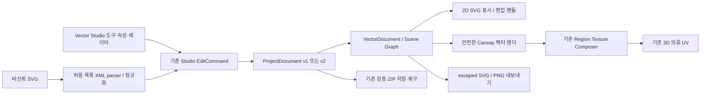

# Vector Studio 아키텍처

Vector Studio는 기존 프로젝트 내부 작업 공간이다. 기존 Three.js 뷰어, 의류 mesh/UV, 래스터 레이어, 안전 파일 경계와 공통 Undo를 재사용한다. 별도 데모 앱·별도 저장·별도 명령 history를 만들지 않는다.

## 모듈 책임

| 실제 위치 | 역할 |
|---|---|
| src/types/vector.ts | VectorDocument/Object/Artboard/Anchor/Paint/Stroke의 JSON 계약 |
| src/core/vector/document.ts | 문서·객체 생성, scene 부모/자식 및 world matrix 계산 |
| src/core/vector/validation.ts | 필드·숫자·ID·예산·참조·계층 순환·누적 matrix 검증 |
| src/core/vector/geometry.ts | 도형, 경로 parser, 베지어·bounds·행렬·앵커 분할/삭제/연결/복합 |
| src/core/vector/boolean.ts | 결정적 곡선 평탄화 후 polygon Boolean, 출력은 실제 path |
| src/core/vector/svg.ts | 안전 XML import, 지원 subset 정규화, SVG XML export |
| src/core/vector/render.ts | 문서 path/text/image/gradient/clip를 Canvas에 직접 렌더; PNG·UV에 공유 |
| src/features/vector-studio | 도구 상태·캔버스·속성·레이어·단축키; 영속 편집은 callback 명령 |
| src/state/studio.ts | vector.document.set와 garment binding을 기존 history에 합류 |
| src/core/textures/composer.ts | image/text/vector 레이어를 동일 region 순서로 합성 |

문자 외곽선은 `src/core/vector/text.ts`가 로컬 OFL font를 공개 OpenType API로 변환한다. UI 컴포넌트에 비신뢰 XML parser나 ZIP 해제 구현을 넣지 않는다.

## 문서·좌표

객체 배열은 parentId로 그룹 계층을 표현하며 배열 순서가 형제의 페인트 순서다. path의 contour는 열린/닫힌 앵커 배열이고 각 앵커의 `in/out`은 해당 객체 로컬 좌표계의 절대 핸들 위치다. 2차 곡선과 SVG 타원호는 편집 가능한 3차 베지어로 정규화한다. `fillRule`은 실제 복합 패스의 구멍을 결정한다.

객체 transform은 `[a,b,c,d,e,f]` affine matrix다. scene parent부터 local까지 곱하며 화면 zoom/pan을 문서 좌표에 저장하지 않는다. artboard의 x/y/width/height도 문서 좌표다. 아트보드 단위는 px/mm/cm/pt이며 변환 기준은 CSS 96px/in, 25.4mm/in, 72pt/in이다. 표시 단위가 실제 의류 생산 치수/인쇄 보정을 보장하지 않는다.

## 기존 명령·History Adapter

Vector UI의 편집은 immutable VectorDocument를 생성해 기존 `studio.execute`의 `vector.document.set`으로 보낸다. 객체 생성·변형·앵커·색·Boolean·그룹·문자·아트보드는 이 명령을 공유한다. drag는 임시 preview 후 한 commit이거나 기존 beginGroup/endGroup으로 한 Undo 항목이어야 한다. 선택·도구·zoom/pan은 UI 세션 상태다. Undo/Redo는 같은 ProjectDocument를 복원하므로 vector 원본과 3D texture 입력이 함께 바뀐다.

garment bind는 원본 문서 ID·artboard ID를 가진 `type: vector` artwork layer를 기존 activeRegion에 만든다. layer의 중심 x/y, 크기, 회전, 표시, opacity는 기존 artwork 좌표 계약을 따른다. 이미 연결된 문서를 편집해도 layer 배치가 변하지 않는다. 렌더용 PNG만 남기는 흐름은 금지한다.

## 렌더·신뢰 경계

화면은 앱이 생성한 path/paint/text만 표시하고 업로드 원본 SVG 문자열을 실행 DOM으로 삽입하지 않는다. UV/PNG 출력은 검증된 path를 Canvas Path2D로 그린다. 지역 합성기는 artboard를 투명 canvas로 요청한 뒤 기존 레이어 transform으로 붙인다. model geometry/UV를 바꾸지 않는다. cache key에는 문서 내용·원본 PNG·출력 크기를 포함하고 LRU 한도를 둔다.

SVG import는 크기/문법/허용요소/참조/예산 검증 후 자체 문서로 정규화한다. 외부 href와 CSS 네트워크는 거부한다. 이미지 asset은 기존 검증을 통과한 embedded PNG만 사용할 수 있다. 출력은 자체 escaped XML writer를 통과하고 비신뢰 attributes/markup을 재사용하지 않는다. 상세한 지원과 손실 경고는 [형식 정책](VECTOR_FILE_FORMAT.md)을 따른다.

## 설계상 한계

Boolean은 해석적 곡선 교차를 약속하지 않는다. 문서 좌표에 고정된 tolerance로 곡선을 폴리라인으로 근사한 뒤 실제 경계를 계산한다. Boolean 기본 평탄화 오차는 문서 좌표 0.25px다. SVG 타원호는 3차 베지어 근사 오차 0.01px 이내를 목표로 분할한다. 기하 연산은 확대와 무관하다. 자기교차·퇴화 등 지원하지 않는 입력은 명시적으로 거부해야 하며 제한을 테스트한다. P2 offset/trace·P3 CMYK/ICC와 생산용 CAD를 이 모듈의 완료 기능에 포함하지 않는다.
